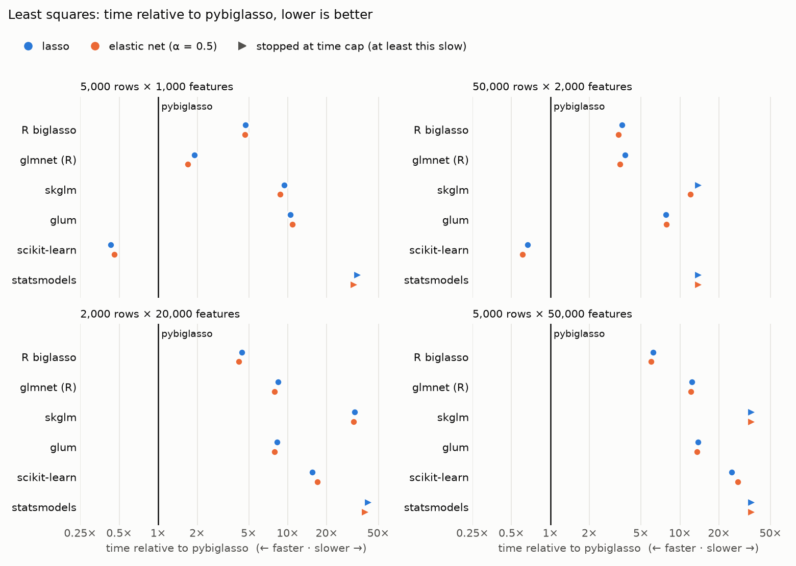
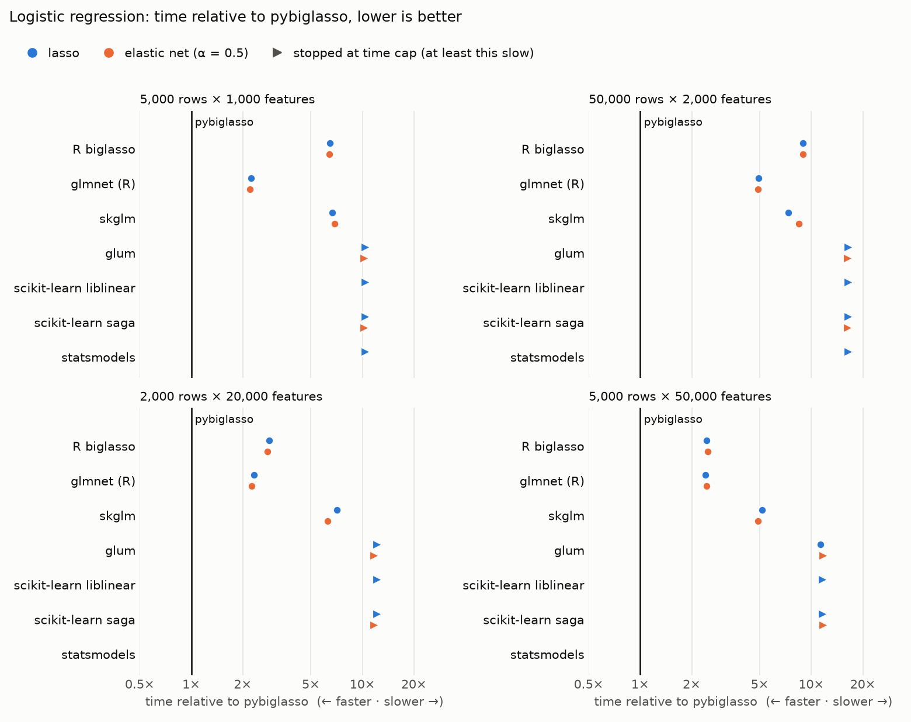

# pybiglasso

[](https://github.com/mmacpherson/pybiglasso/actions/workflows/ci.yml)
[](https://github.com/mmacpherson/pybiglasso/actions/workflows/r-live.yml)
[](https://results.pre-commit.ci/latest/github/mmacpherson/pybiglasso/main)

[](https://pypi.org/project/pybiglasso/)
[](https://pypi.org/project/pybiglasso/)
[](https://pypi.org/project/pybiglasso/)

[](https://github.com/mmacpherson/pybiglasso/blob/main/LICENSE)
[](https://pypi.org/project/pybiglasso/)
[](https://github.com/astral-sh/uv)
[](https://github.com/astral-sh/ruff)

**Lasso and elastic-net regression for data larger than memory.**

If your penalized regression won't fit in memory, pybiglasso fits it where the
data already is: on disk. On an ordinary desktop with six solver threads, a
20-step path over a 12 GB design matrix fits under a 3 GB memory limit in under
two minutes (see [Performance](#performance)).

Save the matrix as a numpy memmap and pybiglasso fits the whole regularization
path, with cross-validation to choose the penalty, without loading it into
memory.

To try it without installing anything, open the
[playground](https://mmacpherson.github.io/pybiglasso/). It runs the same Rust
solver, compiled to WebAssembly, in your browser, on example datasets or your
own CSV or Parquet file, which never leaves your machine, and can
cross-validate the fit.

pybiglasso fits least-squares (Gaussian) and logistic (binomial) models, and
it's also fast when the data does fit in memory. At one thread, for logistic
lasso across four benchmark problems with 1,000 to 50,000 features, a full
100-step path runs 1.9–2.8x faster than R's glmnet, 3.5–6.1x faster than R
biglasso, and 4.3–6.2x faster than skglm, the fastest of the other Python
solvers we tested. On the one-thread least-squares lasso benchmarks, it is
3.3–5.6x faster than R biglasso and 1.4–3.5x faster than glmnet.
Scikit-learn is faster on tall data and slower on wide data; its wide lasso
fits are less accurate at the default settings (see [Performance](#performance)).

It is an unofficial Python port of the R package
[biglasso](https://github.com/pbreheny/biglasso), and with
`r_compatible=True` reproduces its results to floating-point precision for
both families. The default mode has deliberate differences, checked against a
plain reference implementation and independent optimality conditions (see
[Validation](#validation)).

## Install

```
pip install pybiglasso
```

The core depends only on numpy and scipy; the solver is compiled Rust, in the
wheel. Extras add optional integrations:

| extra | adds |
|---|---|
| `pybiglasso[sklearn]` | `BiglassoRegressor`, `BiglassoRegressorCV`, `BiglassoClassifier`, `BiglassoClassifierCV` |
| `pybiglasso[viz]` | `plot_coefficients()`, `plot_deviance()` (seaborn.objects) |
| `pybiglasso[arrow]` | Feather files and other PyArrow Tables as X |
| `pybiglasso[ingest]` | converting CSV, Parquet, Feather and Excel files with `ingest` |
| `pybiglasso[all]` | all of the above |

For `BiglassoPath.to_pandas()` or `.to_polars()`, install the package directly
with `pip install pandas` or `pip install polars`.

CI tests the declared minimum versions too; [dependency notes](docs/dependency-versions.md)
record the checks behind those bounds.

## Quick start

```python
import numpy as np
import pybiglasso as bl

# open the matrix on disk without loading it (a read-only memmap); store it
# column-major (Fortran order)
X = np.load("X.npy", mmap_mode="r")
y = np.load("y.npy")

path = bl.biglasso(X, y, alpha=1.0, nlambda=100)   # alpha=1: lasso
path
# BiglassoPath(500000 features, 100 lambdas from 0.112 to 0.000112, alpha=1.0)

path.coef                  # scipy.sparse (features x lambdas)
path.n_nonzero             # model size along the path
path.predict(X_new)        # (rows x lambdas); reads only the columns in use
path.score(X_val, y_val, metric="mse")

path.to_polars()           # lambda_, feature, coefficient (nonzero only)
```

To write such a file, open it as a column-major memmap and fill it a block of
columns at a time, so the whole matrix never has to be in memory:

```python
X = np.lib.format.open_memmap(
    "X.npy", mode="w+", dtype=np.float32,
    shape=(n_samples, n_features), fortran_order=True,
)
for start, block in read_blocks():
    X[:, start : start + block.shape[1]] = block
X.flush()
```

The values can be float64, float32, any integer type, or bool (a byte per
value, read as 0 or 1). Use the narrowest type that holds them exactly: the fit
is mostly reading X, so a narrower type is faster as well as smaller (see
[storage](#threads-cross-validation-and-storage)).

Unpenalized covariates (say age, sex, and principal components) take a penalty
factor of 0:

```python
pf = np.ones(X.shape[1])
pf[:12] = 0
path = bl.biglasso(X, y, penalty_factor=pf)
```

### Least squares and logistic regression

`family` chooses the model. Least squares (`"gaussian"`) is the default, as in
R biglasso; for a 0/1 response, pass `family="binomial"`:

```python
model = bl.biglasso(X, y_binary, family="binomial")
model.predict_proba(X_new)       # (rows x lambdas)
model.score(X_val, y_val, metric="auc")
```

The two families share one solver, in Python and in the browser playground,
and the same path options. A least-squares path predicts the response,
reports the residual sum of squares as `deviance`, and scores by
`"deviance"`, `"mse"`, or `"r2"`. A logistic path predicts classes, with
log-odds from `decision_function` and probabilities from `predict_proba`,
reports the binomial deviance, and scores by `"deviance"`, `"auc"`, or
`"accuracy"`.

### scikit-learn

The scikit-learn interface has an estimator for each family:
`BiglassoRegressor` and `BiglassoClassifier` fit at one penalty strength, and
`BiglassoRegressorCV` and `BiglassoClassifierCV` choose it by
cross-validation. All four pass scikit-learn's estimator checks and work in
pipelines and grid searches (install `pybiglasso[sklearn]`).

```python
from pybiglasso import BiglassoRegressorCV, BiglassoClassifierCV

reg = BiglassoRegressorCV(l1_ratio=1.0, cv=5).fit(X, y)
clf = BiglassoClassifierCV(l1_ratio=1.0, cv=5, rule="1se").fit(X, y_binary)
clf.alpha_, clf.coef_
```

The estimators use scikit-learn's parameter names, which differ from R's:

| scikit-learn | R / `pybiglasso.biglasso` | meaning |
|---|---|---|
| `alpha` | `lambda` | penalty strength |
| `l1_ratio` | `alpha` | L1/L2 mix; 1 is the lasso |

### What X can be

The design matrix X can be any of the types below. The first two are
memory-mapped from a file: their data stays on disk and is read a column at a
time, so it can be larger than memory.

| X | Made with | Its data during the fit |
|---|---|---|
| NumPy memmap of a `.npy` file | `np.load(path, mmap_mode="r")` | on disk; one type for the whole matrix |
| PyArrow Table mapped from a Feather file | `pyarrow.feather.read_table(path, memory_map=True)` | on disk if the file is uncompressed; a type per column, bools at one bit |
| NumPy array | — | in memory |
| pandas or Polars DataFrame | — | converted to a NumPy array in memory, which may copy it; feature names come from its columns |

[Getting your data in](docs/data.md) has tested recipes for getting from CSV,
Parquet, Excel, databases, or PLINK and VCF genotypes to one of these.

## Why this exists

At 23andMe, I used R's biglasso package to fit penalized models on large
genotype/phenotype datasets without loading them into memory. Over a holiday
break, I ported it to Python, using numba for speed, partly to gain a better
understanding of how it worked and partly because, assuming I could get it
working, it would be convenient to stay within the Python ecosystem. I validated
it against R biglasso, matching its coefficients, lambda grid, and iteration
counts to floating-point precision, and benchmarked it on data both smaller and
larger than memory.

In 2026 I revived the port for release, working with coding agents (Claude Code
and Codex). That work added least-squares regression, the scikit-learn
estimators and cross-validation, extended the validation (against R across many
more configurations, and with checks independent of R, which turned up the
differences listed below), rewrote the solver in Rust, and carried the
performance work and benchmarks further.

This is an independent port, not affiliated with or endorsed by the biglasso
authors: Yaohui Zeng, Chuyi Wang, Tabitha Peter, and Patrick Breheny. If you use
it, please cite their paper (below).

## Validation

pybiglasso is checked two ways: against R biglasso, which it ports, and
against checks that don't depend on R, which also cover the few places where
the two differ (see [Differences](#differences-from-r-biglasso)).

**Against R.** Every push runs pybiglasso against stored R biglasso 1.7.2
output for 192 configurations (40 least-squares and 152 logistic), comparing
coefficients, deviance, the lambda grid, centering and scaling, strong-rule
rejections, and the iteration count at
every lambda, with `rtol=1e-9`. The grid covers wide and tall problems,
genotype-like dosage data (including int8 and uint8 storage), memmaps, float32,
row subsets, penalty factors (including zeros), user-supplied and linear lambda
grids, `dfmax` truncation, and saturation. The comparison runs pybiglasso with
`r_compatible=True`; for cases with penalty factors it passes R pybiglasso's
lambda grid, which sets aside the zero-penalty-factor case under Differences.
A weekly job reruns the grid live against the current CRAN release, to catch
upstream changes. The two agree to floating-point precision rather than bit
for bit: R sums serially, while pybiglasso sums in a fixed order across several
accumulators, so that SIMD and threads don't change its results, and groups a
few operations differently.

**Independent of R.**

- **Optimality.** Converged test paths satisfy the elastic-net optimality
  (KKT) conditions to 1e-6, on wide, correlated, partly unpenalized, and genotype-like
  designs, for both families; duality gaps, some in exact arithmetic, and
  curvature bounds certify how close the coefficients are to the optimum.
- **Reference solutions.** Small problems are solved without pybiglasso, from
  closed forms (orthogonal designs, single features) or by enumerating every
  active set, and the fits are held to those solutions within derived
  numerical bounds.
- **Other solvers.** R's glmnet minimizes the same objective; its paths are
  stored from a pinned release and checked at every lambda, for least squares
  and for logistic fits, including rare-response fits whose log-odds exceed
  R biglasso's cutoff of 10. For logistic regression, scikit-learn's saga
  solver, tightly converged, finds the same coefficients as well: each pair
  passes the optimality conditions, and then their distance is certified, to
  about 1e-7 on tall data and, through the duality gap, to about 1e-5 on wide
  data (all but the wide lasso, whose optimum need not be unique). In the
  benchmarks, glum reaches the same elastic-net objective too.
- **Where R differs.** R's elastic-net update (reproduced by
  `r_compatible=True`) doesn't satisfy the optimality conditions, and its
  coefficients differ from saga's by 2–50% of their size on the test problem.
  This is the basis for the elastic-net difference under Differences.
- **Shifted data.** Adding 1e8 to every column of X leaves the solution
  unchanged and still optimal; this is the case described under Differences
  as data far from zero.

```
uv run pytest               # against stored R output; no R needed
make test-r                 # live, in a container (CONTAINER=podman works too)
make test-r R_VERSION=latest
make soak                   # larger memory-mapped problems; for a big machine
make soak-hypothesis        # property tests, wide random search (part of soak)
```

## Performance

These benchmarks measure speed; correctness is established separately, against
R biglasso and by checks independent of it (see [Validation](#validation)). In
memory, every solver is given the same problem and the same 100-value lambda
path, at its own default tolerance, and its accuracy is reported alongside its
time. All ran on an AMD Ryzen 5 5600X (6 cores, 12 threads) with 64 GB of RAM,
Python 3.14, and R 4.6.1, at 1, 6 and 12 threads for least squares and at 1
and 6 for logistic regression; each solver is shown at its
smallest observed time among its declared thread settings. This is descriptive,
not evidence of an optimal thread count. A time is the median of three fresh
processes, or a labelled single observation when repetition ends early.

Each time covers the solver's own fitting calls. pybiglasso, R biglasso and
glmnet standardize raw X themselves, inside that time. The Python solvers,
which don't standardize, were given X already standardized; the benchmark's
own preparation for them (centering the data for scikit-learn's least-squares
path, and recovering its intercept) is outside it. Scikit-learn's default
defensive copy (`copy_X=True`) is inside the least-squares timer. Python
competitors were
stopped at 10x pybiglasso's single-threaded time, and at no less than 5
seconds, which would otherwise have stretched the runs to many hours; R gets a
fixed 900 seconds. Since pybiglasso is shown at its fastest thread count, a
stopped run sits beyond 10x in the figures. The scripts and raw results are in [`benchmarks/`](benchmarks/).

### Least squares

<picture>
  <source media="(prefers-color-scheme: dark)" srcset="docs/benchmarks-least-squares-dark.png">
  
</picture>

These timings depend on the [recording policy](benchmarks/gaussian-records.md#conditional-in-memory-recording-policy).
An external controller reset the page cache and enforced memory reserves for
every solver. That keeps memory pressure low; a busy machine can behave
differently. The repository's runners do not include that controller.

Scikit-learn took less time on the tall problems; pybiglasso on the wide ones.
With many more rows than features, scikit-learn's `enet_path` forms the Gram
matrix XᵀX once and runs coordinate descent on that smaller matrix. Each uses its default tolerance, so these times are for the accuracy shown,
not for the same accuracy. Scikit-learn's wide lasso fits have larger optimality
(KKT) residuals, shown below. Times are seconds, lasso / elastic net (α=0.5).
**† marks one completed run**; unmarked completed cells are three-run medians.
**≥ means a fit stopped at its time limit**, with that lower bound rounded
down; its full-path accuracy is unavailable. The figure uses these same
settings, with the sample counts and accuracy shown in the tables.

| Solver | 5,000 × 1,000 | 50,000 × 2,000 | 2,000 × 20,000 | 5,000 × 50,000 |
|---|---|---|---|---|
| pybiglasso | 0.14 / 0.15 | 1.26 / 1.40 | 0.21 / 0.22 | 0.90 / 0.92 |
| R biglasso | 0.68 / 0.72 | 4.49 / 4.65 | 0.92 / 0.93 | 5.57 / 5.49 |
| glmnet (R) | 0.28 / 0.26 | 4.71 / 4.78 | 1.75 / 1.74 | 11.18† / 11.09† |
| skglm | 1.36 / 1.35 | ≥ 17.51 / 16.80† | 6.82† / 7.09† | ≥ 32.06 / ≥ 32.61 |
| glum | 1.51 / 1.68† | 9.77† / 10.94† | 1.72 / 1.73 | 12.43† / 12.40† |
| scikit-learn | 0.06 / 0.07 | 0.84 / 0.85 | 3.19† / 3.72† | 22.62† / 25.68† |
| statsmodels | ≥ 5.00 / ≥ 5.00 | ≥ 17.51 / ≥ 19.35 | ≥ 8.69 / ≥ 8.76 | ≥ 32.06 / ≥ 32.61 |

For lasso (α=1), native seconds and maximum KKT residual in response units:

| Rows × features | pybiglasso seconds; max KKT | scikit-learn seconds; max KKT |
|---|---|---|
| 5,000 × 1,000 | 0.14; 9.96e-5 | 0.06; 5.00e-5 |
| 50,000 × 2,000 | 1.26; 1.09e-5 | 0.84; 4.48e-5 |
| 2,000 × 20,000 | 0.21; 7.81e-6 | 3.19†; 1.24e-2 |
| 5,000 × 50,000 | 0.90; 5.43e-6 | 22.62†; 1.22e-2 |

Every completed path reached all 100 lambdas without warnings. The
[accuracy table](benchmarks/gaussian-records.md#achieved-accuracy) reports KKT
residuals and objective differences for every solver alongside its time,
with every other thread setting retained in the result records.

Some runs were retried under the [policy's limits and disclosed exceptions](benchmarks/gaussian-records.md#conditional-in-memory-recording-policy);
no run was rejected for its speed.

### Logistic regression

<picture>
  <source media="(prefers-color-scheme: dark)" srcset="docs/benchmarks-logistic-dark.png">
  
</picture>

These timings depend on the [recording policy](benchmarks/logistic-records.md#conditional-in-memory-recording-policy),
under the same external controller as least squares.

pybiglasso is the fastest on every dataset: 2.2–4.9x faster than glmnet,
2.3–8.4x faster than R biglasso, and 4.8–8.5x faster than skglm, the fastest of
the Python solvers. Each uses its default tolerance, so these times are for the
accuracy shown, not for the same accuracy. Times are seconds, lasso / elastic
net (α=0.5). **† marks one completed run**; unmarked completed cells are
three-run medians. **≥ means a fit stopped at its time limit**, with that lower
bound rounded down; its full-path accuracy is unavailable.

| Solver | 5,000 × 1,000 | 50,000 × 2,000 | 2,000 × 20,000 | 5,000 × 50,000 |
|---|---|---|---|---|
| pybiglasso | 0.63 / 0.65 | 6.37 / 6.44 | 1.12 / 1.16 | 6.93 / 7.02 |
| R biglasso | 4.03† / 4.16† | 53.6† / 53.5† | 3.04 / 3.10 | 16.1 / 16.5 |
| glmnet (R) | 1.49 / 1.54 | 31.4 / 31.0 | 2.48 / 2.55 | 15.7 / 16.1 |
| skglm | 4.21† / 4.61† | 47.1† / 55.0† | 7.65† / 7.10† | 34.7† / 33.7† |
| glum | ≥ 6.78 / ≥ 6.91 | 107† / 110† | ≥ 13.0 / ≥ 13.5 | 74.6† / ≥ 80.3 |
| scikit-learn liblinear | ≥ 6.78 / — | ≥ 110 / — | ≥ 13.0 / — | ≥ 79.3 / — |
| scikit-learn saga | ≥ 6.78 / ≥ 6.91 | ≥ 110 / ≥ 110 | ≥ 13.0 / ≥ 13.5 | ≥ 79.3 / ≥ 80.3 |
| statsmodels | ≥ 6.78 / — | ≥ 110 / — | — / — | — / — |

**Which solvers.** R biglasso, the original; R's glmnet, whose coordinate
descent biglasso builds on; and every maintained Python package, installable
with pip, that fits L1 or elastic-net logistic regression on a CPU:
scikit-learn (its liblinear and saga solvers), glum, skglm, and statsmodels.
liblinear and statsmodels fit the lasso only. liblinear also penalizes the
intercept, so its fit is a slightly different problem; it is shown for
reference. statsmodels ran only on the tall datasets: its L1 fit uses a
general-purpose optimizer with dense matrices over twice the columns, which
would need about 12 GB and 76 GB on the wide ones.

**Accuracy.** For lasso (α=1), native seconds and the largest optimality (KKT)
residual along the path:

| Rows × features | pybiglasso seconds; max KKT | glmnet seconds; max KKT | skglm seconds; max KKT |
|---|---|---|---|
| 5,000 × 1,000 | 0.63; 4.18e-5 | 1.49; 4.95e-5 | 4.21†; 9.75e-5 |
| 50,000 × 2,000 | 6.37; 1.25e-5 | 31.4; 1.13e-5 | 47.1†; 9.65e-5 |
| 2,000 × 20,000 | 1.12; 2.62e-5 | 2.48; 3.13e-5 | 7.65†; 2.48e-5 |
| 5,000 × 50,000 | 6.93; 1.85e-5 | 15.7; 2.60e-5 | 34.7†; 3.35e-5 |

glmnet's KKT residuals are about as small as pybiglasso's. Every completed path
reached all 100 lambdas without warnings. For the lasso, R biglasso and
pybiglasso use the same coordinate update and reach similarly small residuals on
these problems. For the elastic net, R biglasso and pybiglasso with `r_compatible=True`, which
matches R and takes about as long as its default, use R's legacy update (see
[Differences](#differences-from-r-biglasso)), which is not matched to the common
elastic-net objective. Their KKT residuals against that objective remain useful
diagnostics, but these timings are not an equal-objective comparison. R's adaptive screening rule is about
as fast as SSR on these problems. The
[accuracy table](benchmarks/logistic-records.md#achieved-accuracy-beside-the-observed-times)
lists every solver's residual beside its time, including pybiglasso with
`eps=1e-10`.

**With a relaxed limit.** To show how long the stopped solvers take, the
smallest problem (5,000 × 1,000) also ran with the limit raised to 1,000x
pybiglasso's time, up to 900 seconds. Completed times are three-run medians;
statsmodels stopped at the limit:

| Solver | Lasso | Elastic net (α=0.5) | Max KKT, lasso |
|---|---|---|---|
| pybiglasso | 0.64 s | 0.65 s | 4.2e-5 |
| pybiglasso, `eps=1e-10` | 1.46 s (2.3x) | 1.38 s (2.1x) | 1.1e-6 |
| glmnet 5.1 (R) | 1.48 s (2.3x) | 1.37 s (2.1x) | 5.0e-5 |
| R biglasso 1.7.2 | 4.01 s (6.3x) | 4.03 s (6.2x) | 4.2e-5 |
| skglm | 4.21 s (6.6x) | 4.41 s (6.8x) | 9.7e-5 |
| glum | 9.10 s (14x) | 8.94 s (14x) | 2.9e-5 |
| scikit-learn liblinear | 21.0 s (33x) | — | 1.4e-3 |
| scikit-learn saga | 91.3 s (144x) | 92.9 s (144x) | 3.1e-3 |
| statsmodels | over 681 s (over 1,000x) | — | — |

liblinear raised 200 warnings from scikit-learn on each path, about its
arguments rather than convergence: 100 that its `penalty` argument is
deprecated and 100 about parameter consistency. Every other completed path ran
without warnings.

To run both families and redraw the figures and tables (both families'
recording policies need the external controls described above):

```bash
make r-image R_VERSION=4.6.1  # once
export CONTAINER=docker R_IMAGE=pybiglasso-r:r4.6.1 THREADS="1 6 12"
DATASETS="tall-5k-1k tall-50k-2k wide-2k-20k wide-5k-50k" \
  benchmarks/run-gaussian.sh benchmarks/results/path-gaussian-local.jsonl
THREADS="1 6" benchmarks/run-path.sh local
make benchmark-figures GAUSSIAN_RESULTS=benchmarks/results/path-gaussian-local.jsonl \
  LOGISTIC_RESULTS=benchmarks/results/path-local.jsonl
```

### Out of core

#### Least squares

This fits an uncompressed 12 GB float64 matrix (20,000 × 75,000) under a
3 GiB memory cap. pybiglasso reads a NumPy memmap; R biglasso 1.7.2 reads a
prepared file-backed `big.matrix`. The page cache was evicted before each fit.

Both fit the same 20-lambda lasso path in three rounds in a fixed order.
Times are medians, **n=3 per setting**, with min–max spread; input preparation
and process setup are outside the fit timer. The [record](benchmarks/results/out_of_core-gaussian.json)
contains all nine observations.

| Solver | Median fit seconds (min–max) | Peak memory | Median data read from disk |
|---|---|---|---|
| pybiglasso, 1 thread | 122.3 (120.3–127.9) | 3 GiB | 282.2 GB |
| pybiglasso, 6 threads | 106.2 (101.9–106.8) | 3 GiB | 291.8 GB |
| R biglasso, 1 thread | 116.0 (114.3–117.4) | 3 GiB | 286.4 GB |

The fits are disk-bound and roughly even, not a speed claim. All six Python
paths are byte-identical across threads and rounds. R agrees within 1e-9
relative / 1e-11 absolute tolerances, with identical iterations and rejection
counts in all three rounds.

The [methods](benchmarks/gaussian-records.md#out-of-core-recording-policy)
cover the fixed order, memory accounting and environment checks.

#### Logistic regression

The same 12 GB matrix (20,000 × 75,000), under the same 3 GiB memory cap and
with the page cache evicted before each fit, here fits a 20-lambda logistic
lasso path. pybiglasso reads a NumPy memmap; R biglasso 1.7.2 reads a prepared
file-backed `big.matrix`. Three rounds ran in a fixed order; times are medians,
**n=3 per setting**, with min–max spread. The
[record](benchmarks/results/out_of_core-logistic.json) contains all nine
observations, with each fit's data read and page faults.

| Solver | Median fit seconds (min–max) | Median data read from disk |
|---|---|---|
| pybiglasso, 1 thread | 142.5 (137.1–161.8) | 342.8 GB |
| pybiglasso, 6 threads | 114.6 (113.1–118.2) | 322.0 GB |
| R biglasso, 1 thread | 162.8 (156.3–184.8) | 347.9 GB |

This comparison is I/O-intensive: under the cap, each fit read hundreds of GB
from disk. On the medians,
pybiglasso was about 1.1x faster than R at one thread and 1.4x faster at six;
the one-thread ranges overlap, and at six threads it was faster than R in every
round. Data read and fault counts vary from run to run, and these records don't
identify why. All six Python paths are byte-identical across threads and rounds.
R agrees within 1e-9 relative / 1e-11 absolute tolerances, with identical
iterations and rejection counts in all three rounds.

The [methods](benchmarks/logistic-records.md#memory-capped-out-of-core) cover
the fixed order, memory accounting and file checks.

### Not compared

Some solvers fall outside the rule above:

- Other languages: Julia's GLMNet.jl, a wrapper of glmnet's earlier Fortran
  solver, and Lasso.jl, written in Julia.
- Other hardware: RAPIDS cuML fits on a GPU, and only data that fits in GPU
  memory.
- Unmaintained: python-glmnet, archived, with its last release in 2020.
- A different problem: celer's logistic regression fits the lasso only, and no
  intercept. skglm, from the same authors, fits an intercept and the elastic
  net, and is compared above.
- Not a solver: benchopt is a benchmarking framework; its logistic-regression
  benchmark fits without an intercept or standardization, which pybiglasso
  doesn't support yet.

## Differences from R biglasso

pybiglasso follows R biglasso 1.7.2 closely, matching it coefficient for
coefficient and down to its iteration and screening counts. It departs in a few
places, mostly where we think R's behavior may not be what was intended; if
we've erred we'd be glad to be corrected. Each departure is marked in the code
with a comment beginning "Differs from R biglasso".

**Both families.**

- **Zero penalty factors.** With a `penalty.factor` of 0 and the default
  lambda grid, R's grid comes out as `lambda = 0` at every step. pybiglasso
  instead fits the unpenalized columns first, and starts the path at the
  smallest lambda that keeps every penalized column at zero.
- **Default `lambda_min`.** R chooses 0.001 or 0.05 by comparing `nrow(X)` with
  `ncol(X)`; pybiglasso compares the number of rows actually fit, which differs
  when `row_indices` is given.
- **Data far from zero.** For columns whose mean is large next to their spread
  (say, values near 1e8 that vary by 1), standardizing from raw sums loses
  precision in floating point. R's scales, and so its fit, can be affected
  without a warning; in our tests some scales came out as NaN. pybiglasso
  computes these columns' moments from centered values. A column whose values
  are huge next to their spread (near 2^54, varying by a few units) can still
  have a mean that float64 cannot represent. pybiglasso warns and names usable
  columns whose measured remaining standardized mean exceeds 1e-6 in magnitude.
  This can make the fit, its intercept especially, inaccurate. An absent warning
  doesn't guarantee accurate scaling or an accurate raw intercept: even a
  well-centered fit can lose precision when its intercept is expressed on X's
  raw scale. Subtract a reference value, such as each column's minimum, before
  fitting such data.
- **Residual centering (default mode).** R uses the column sum divided by its
  row count as the center. When a usable column's measured standardized mean
  exceeds 1e-6 in magnitude, pybiglasso's default mode adds the mean of its
  centered values to that center, then recomputes the moments in another
  streaming pass if the center changed. This is a partial repair: one float64 center cannot always
  represent the mean, and the warning above can remain. `r_compatible=True`
  keeps the column-sum center and two-pass scale.
- **Arithmetic order.** R sums serially; pybiglasso sums in a fixed order
  across several accumulators, so SIMD and threads don't change its results,
  and groups some products and quotients differently. Results can differ from
  R's in the low bits, and agree to floating-point precision (see
  [Validation](#validation)).
- **Invalid input.** NaN or infinite values in the rows being fit, and
  non-finite penalty factors or lambdas, raise `ValueError`; R instead drops
  the affected column or returns the null model.
- **Unrepresentable grids.** If an automatic grid overflows (for example,
  with extremely small positive `alpha`), R returns non-finite penalties, and
  pybiglasso raises `ValueError`, for both families and in both modes. Finite
  supplied grids remain supported, including in compatibility mode.

**Least squares.**

- **Residual summation.** R sums updated residuals in row order. By default,
  pybiglasso sums them in a fixed eight-lane tree within 2,048-row blocks,
  without changing each row's update. This lets SIMD accelerate the sweep;
  coefficients and the automatic lambda grid can differ in their last bits.
  `r_compatible=True` keeps the serial order.

- **Constant responses.** R's strict convergence comparison against
  a zero null loss uses the full iteration budget for a constant response.
  pybiglasso stops once the coefficients no longer change;
  `r_compatible=True` retains R's comparison.
- **Zero maximum penalty.** R's logarithmic grid calculation can
  produce non-finite values when the maximum penalty is zero. pybiglasso
  returns a finite all-zero grid, whose fits solve the unpenalized problem.
- **Loss after an iteration limit.** R can leave `loss` at zero when
  the budget ends with outstanding KKT violations. pybiglasso reports the
  returned model's residual sum of squares; `r_compatible=True` retains R's
  bookkeeping.

**Logistic regression.**

- **Elastic-net update.** For `alpha < 1`, R's logistic coordinate update divides by
  `v * (1 + l2)`, where the elastic-net objective in its documentation calls
  for `v + l2`, so the two solve somewhat different problems. pybiglasso uses
  `v + l2`, as glmnet and scikit-learn do; `r_compatible=True` uses R's
  update.
- **Probability clipping.** R sets probabilities
  to 0 or 1 beyond `|eta| > 10`, with weights of `1e-4`. Default mode uses
  glmnet's `pmin = 1e-9` boundary, `|eta| > log(1 / pmin - 1)` (about 20.7).
  This reduces each clipped row's probability error from at most `4.6e-5` to
  `1e-9`. We retain a positive boundary weight of `pmin * (1 - pmin)` so the
  working residual `(y - p) / w` remains defined; glmnet can use zero weights.
  Default-mode coefficients, iterations and screening counts can change,
  for both lasso and elastic net. `r_compatible=True` retains R's cutoff and
  weights. Independent KKT checks against pinned glmnet fits cover the change.
- **Deviance.** `deviance` is the deviance, -2 log-likelihood, of the returned
  model. R reports `loss`, half the deviance, computed before the final
  coordinate sweep and with probabilities clipped at 0 and 1, so it can
  occasionally be infinite. `r_compatible=True` keeps R's version.
- **Saturation.** `stop_on_saturation=False`, an option R doesn't have, fits
  every lambda, even past R's saturation cutoff.

## Threads, cross-validation, and storage

pybiglasso reads the matrix one column at a time, through the memmap, and
never loads or copies it; strong-rule screening skips most columns at most
steps. Cross-validation folds are row indices into the same matrix on disk.

- **Threads help larger fits** (`n_threads=`). By default, `"auto"` (also
  `None`) chooses one thread for a memmap or fewer than 10 million entries in
  the rows and columns being fit (rows × columns), otherwise physical cores
  (performance cores on Apple silicon).
  `RAYON_NUM_THREADS` caps auto; an explicit positive integer overrides it.
  See [the rule and evidence](benchmarks/threads.md). Screening and optimality
  scans run in parallel across columns; tall logistic fits also parallelize
  IRLS across rows. Coordinate descent remains sequential. Results are
  bit-identical at any thread count.
- **Cross-validation scales with cores.** `BiglassoRegressorCV(n_jobs=...)`
  and `BiglassoClassifierCV(n_jobs=...)` fit folds in parallel threads that
  share one X (and, for a memmap, one page cache); results don't depend on
  `n_jobs`.
- **Cross-validation can stop each fold early.** With
  `BiglassoClassifierCV(early_stopping=10)`, a fold's path stops once its
  held-out score has gone 10 alphas without improving, as bigstatsr's
  `big_spLogReg` does, and the fit on all the rows stops at the chosen alpha.
  On wide data, where the end of the path costs most, this saves much of the
  work; the cost is that a better score past the stopping point goes unseen.
  It is off by default.
- **Store X compactly.** Since the work is mostly moving bytes, a narrower
  dtype is faster: small integers (counts, categories, 0/1 indicators) as
  `int8` or `uint8` take 8x less memory and disk than float64, and fit
  1.3–1.6x faster in memory; `float32` halves the memory and is about as fast.
  Each value is read as a float64, so values that a narrower dtype holds
  exactly give bit-identical results.
  Feather files keep bool columns at one bit per value, and each column can
  have its own type (see [What X can be](#what-x-can-be)).
- **Bounds checking is on by default.** Every index into an array is checked,
  which guards against a bug in pybiglasso reading past the end of X (inputs,
  `row_indices` among them, are validated before a fit either way).
  It costs little where X's rows are read in place: a whole Fortran-ordered X,
  or a subset of at least half its rows without repeats, as in
  cross-validation, which is read through a mask. Where every read goes
  through an index or a stride (C-ordered X, or a smaller or repeating
  `row_indices`), it costs up to about 15%. `PYBIGLASSO_BOUNDSCHECK=0` turns it off; the path is the same
  (lambdas, iterations, screening), with identical coefficients.

## How the code is organized

R biglasso implements each family's solver in a few long C++ functions; for
logistic regression, two:
`cdfit_binomial_ssr` standardizes, sets up the lambda grid, and runs the lambda
loop with its strong rule and KKT checks, and `cdfit_binomial_lambda_core` runs
the coordinate descent at each lambda. That keeps the algorithm in a few places,
close to how it's written in the papers.

pybiglasso splits the same algorithm into one small function per step, each
documenting the state it changes, plus a short driver, `fit_lambda`, that reads
like the algorithm's outline. To my eye that's easier to read, test, and modify.
It's a matter of taste, though; some excellent programmers prefer the long
inlined function you can read straight through (John Carmack has
[a good essay](https://web.archive.org/web/20261006034120/http://number-none.com/blow/john_carmack_on_inlined_code.html) on
why). The solver takes the same number of iterations as R's at every lambda; the
R comparison checks this in every case.

The solver is written twice, in the same steps. The one that runs is Rust
(`rust/src/`): one call from Python fits the whole path. The readable one,
[`tests/support/reference.py`](tests/support/reference.py), is plain numpy,
step by step, and imports nothing from pybiglasso; the tests hold the Rust
solver to it, and both to R.

The Rust is laid out by family. `solver.rs` holds what the two share: the
path's parameters, standardization, the scores, and `run`, which hands the fit
to its family. It reads X through `columns.rs`, a column at a time, and sums
with the fixed-order kernels in `kernels.rs`. The logistic solver's own steps
are in `binomial.rs`:

| pybiglasso (`rust/src/`) | R biglasso (`src/`) |
|---|---|
| `center_scale`, `compute_z` (solver.rs) | `standardize_and_get_residual` (utilities.cpp) |
| `update_irls` (binomial.rs) | probability and weight update in `cdfit_binomial_lambda_core` (binomial.cpp) |
| `update_intercept` | intercept update in `cdfit_binomial_lambda_core` |
| `coordinate_sweep` (`Pass`) | coordinate loop in `cdfit_binomial_lambda_core`; `wcrossprod_resid`, `wsqsum_bm`, `lasso` (utilities.cpp) |
| `check` | `check_strong_set`, `check_rest_set` (utilities.cpp) |
| `fit_lambda` | `cdfit_binomial_lambda_core` |
| `run_binomial` | `cdfit_binomial_ssr` |

The least-squares driver and coordinate sweeps, in `rust/src/gaussian.rs`, port
R's Gaussian SSR solver the same way. They share column access,
standardization, and the fixed-order sums with the logistic solver, and since
the curvature is constant they update residuals directly, without the IRLS
step. The numpy reference covers both families.

Every sum over rows runs in an order fixed by the data's shape alone. Threads
split the work by column, and a tall column's rows into 2,048-row chunks whose
sums are added in order. Within a chunk, eight running sums are combined in a
fixed order, so vector instructions of any width (AVX2, AVX-512, ARM's NEON)
give the same result, and no multiply and add are fused into one instruction,
which would round differently. Exponentials and logarithms come from a portable
implementation rather than the operating system's math library, whose last
bits differ between Linux, macOS, and Windows. So results are bit-identical at
any thread count, on any CPU, and on every operating system with a wheel.

## Scope

- Gaussian (least-squares) and binomial (logistic) families; Cox is not ported.
- SSR (sequential strong rule) screening only. R uses its newer Hybrid and
  Adaptive rules only for the plain lasso without penalty factors, and they
  were about as fast as SSR on our benchmarks.

## Citation

> Zeng Y, Breheny P (2021). The biglasso Package: A Memory- and
> Computation-Efficient Solver for Lasso Model Fitting with Big Data in R.
> *The R Journal*, 12(2), 6–19.
> [doi:10.32614/RJ-2021-001](https://doi.org/10.32614/RJ-2021-001)

## License

GPL-3.0-or-later, as R biglasso is GPL-3.
